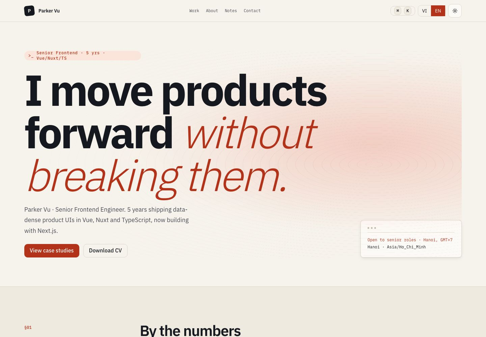
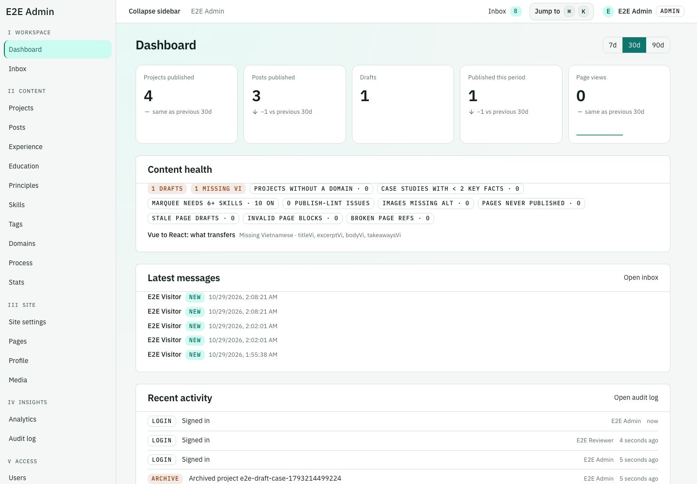
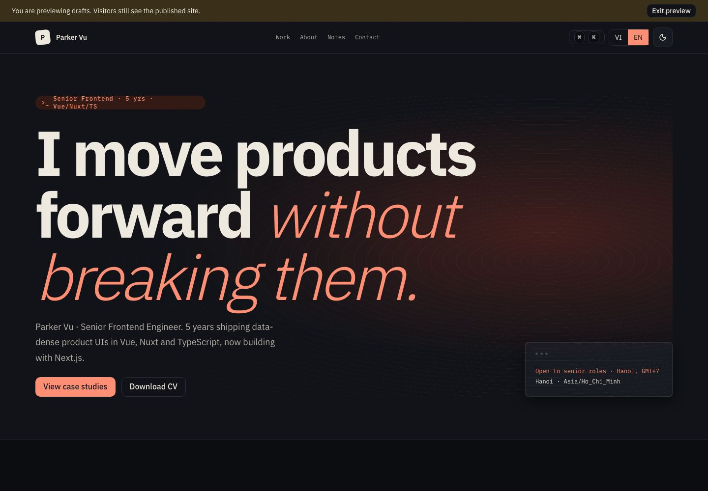
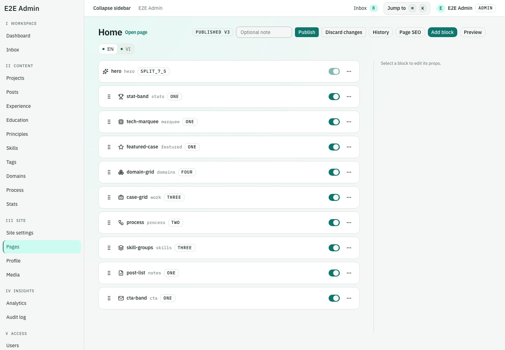
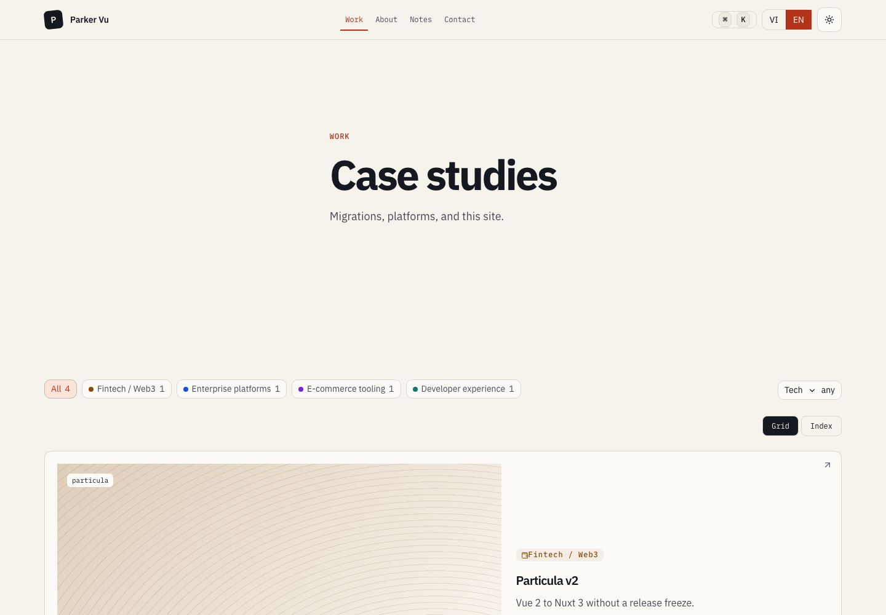
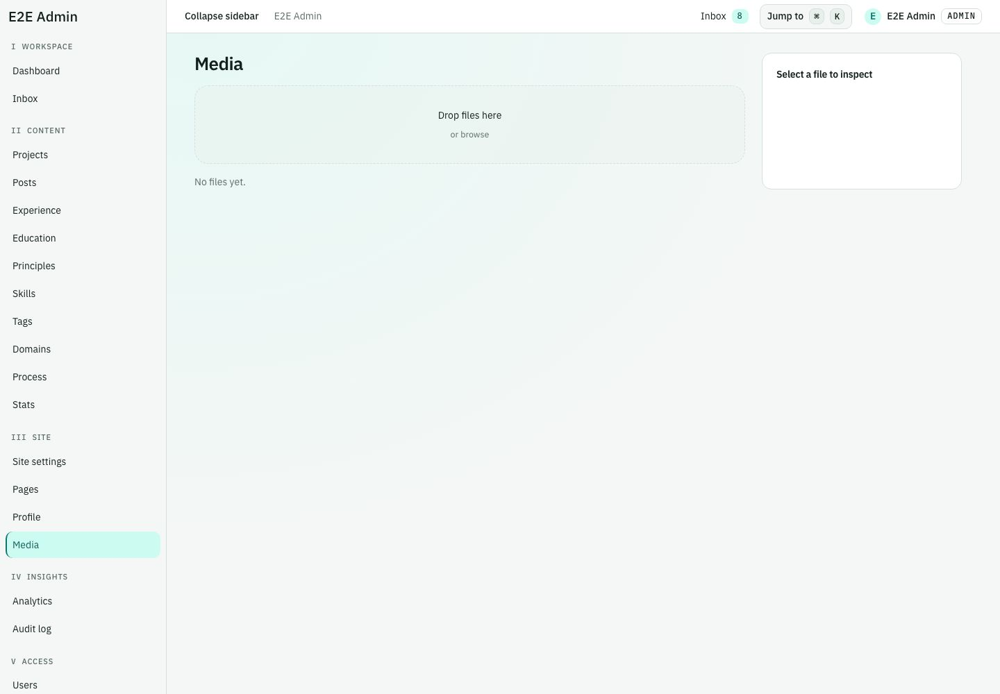
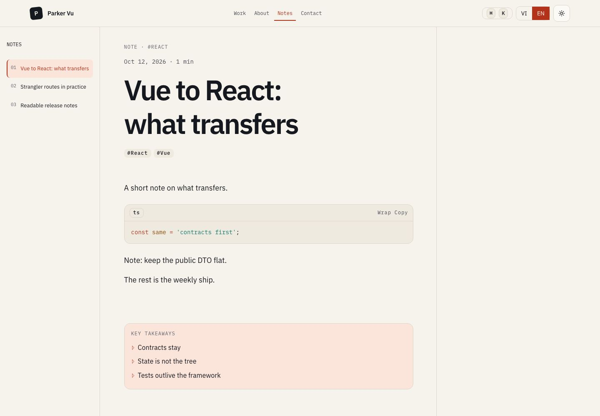
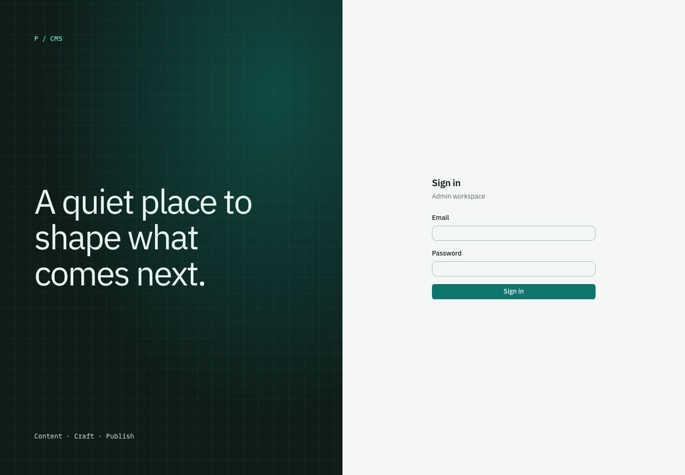
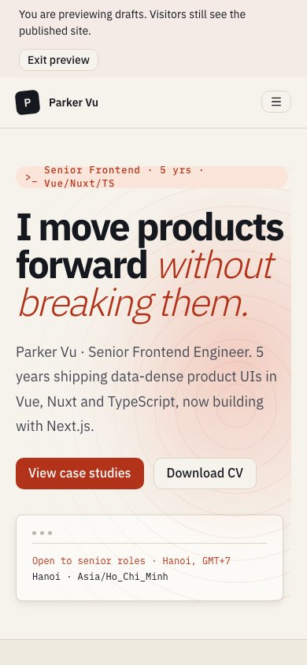
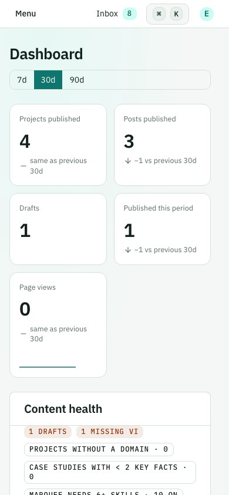

# Ink & Signal implementation review — 29 October 2026

This change applies the design language in `docs/design/redesign` across the public site and CMS. It is a broad implementation for review, not completion of every advanced interaction in the R1–R16 proposal. Screenshots below use the local **demo seed**, not production content.

## Design language

- Public: warm paper (`#f6f3ec`), night ink, restrained red-orange signal; oversized editorial headings with a light italic accent; Plex Mono metadata; hairline rules and numbered section rails.
- CMS: a separate KB teal palette under `.admin`, compact Plex typography, numbered navigation groups, quiet panels, contained tables, and a viewport-height workspace.
- Shared: IBM Plex Sans and Mono with Vietnamese subsets; 10px base radius and 6/8/14/20/28px ladder; progressive squircle corners; reduced-motion and Save-Data fallbacks.
- Content remains sourced from existing APIs and stored block order. Public chrome uses EN/VI translations; CMS follows the existing English-only convention. Backend, contracts and migrations are unchanged.

## Implemented

| Surface                             | Result                                                                                                                                                                                                                                                                                                                                                                 |
| ----------------------------------- | ---------------------------------------------------------------------------------------------------------------------------------------------------------------------------------------------------------------------------------------------------------------------------------------------------------------------------------------------------------------------- |
| Shared foundations                  | Separate public/admin light and dark tokens, typography, radii, AA text contrast tests, compositor shimmer, final-value SSR statistics, SSR-visible reveal, reusable route skeletons and a foundations Storybook story.                                                                                                                                                |
| Public shell                        | Sticky header, monogram, active navigation, existing mobile drawer/search/locale tools, delayed navigation progress, circular theme transition where supported, large footer wordmark.                                                                                                                                                                                 |
| Home and stored blocks              | Large editorial hero, API-backed status card, lazy raw WebGL2 island with static CSS fallback, automatic section numbering, editorial stats/domains/process/notes/CTA styling, desktop case-card stacking, deterministic covers from titles/slugs. Empty resolved blocks are dropped before grouping and spacing.                                                      |
| Projects and case studies           | Grid/Index toggle, existing URL-based filters/pagination, redesigned cards/covers, common container width, Cloudinary blur backgrounds, existing metadata/body/related navigation preserved.                                                                                                                                                                           |
| About and Contact                   | New typography, surface/form styles and section hierarchy; preserved profile/CV/timeline/topic data; stable-width submit loading. Placeholder settings, zero statistics, duplicate hero prompts and duplicate site names in SEO titles are suppressed.                                                                                                                 |
| Notes                               | New index/card styling and desktop three-column reader; list, article and contents remain accessible; reading progress observes the article pane. Mobile keeps document reading.                                                                                                                                                                                       |
| CMS shell and all management routes | Teal scope applies to dashboard, projects, posts, experience, education, principles, skills, tags, domains, process, stats, settings, pages, profile, media, inbox, analytics, audit and users. Sidebar and content scroll independently; mobile drawer remains role-aware. Palette search ignores Vietnamese diacritics and links new records to their actual routes. |
| CMS tables and editors              | Initial pending rows/cards, refetch bar retaining previous data, preserved selection/sorting/pagination/actions, contained editor panes, restyled Tiptap chrome and page-builder rows, live save announcements.                                                                                                                                                        |
| Media and sign-in                   | Desktop media inspector with existing alt-edit/delete behavior, mobile sheet, media loading tiles, upload/pending feedback, split teal sign-in artwork.                                                                                                                                                                                                                |

## Validation

- `pnpm lint`: passes; one existing TanStack Virtual/React Compiler warning in `AdminInsightsAudit.tsx`.
- `pnpm typecheck`: passes.
- `pnpm test`: 373/373 passed (34 contracts, 118 API, 81 UI, 140 web); includes regressions for placeholder detection, title deduplication, accent-insensitive search, empty band removal, SSR visibility/numbers, Cloudinary host checks and palette contrast.
- API production build passes. Web production build passes with `pnpm --filter @portfolio/web exec next build --webpack`. The default Turbopack build hits an environment process/port permission error; the repository build script is unchanged.
- `pnpm test:e2e`: 32/32 passed, including axe, public navigation, contact submission, admin draft/publish/archive, read-only roles, page ordering/version restoration, 390/1440px light/dark layout checks, Vietnamese home, reduced motion, no-JavaScript home, Grid/Index and CMS scroll containment.
- `pnpm --filter @portfolio/ui build-storybook`: passes (existing Vite chunk-size warnings).
- `pnpm check:content`, `pnpm check:deps` and `git diff --check`: passed. The database-wide placeholder audit requires a configured production database; it is not evidence of production content quality here.

Local mobile Lighthouse (production build, demo data; scores vary by machine):

| Page       | Performance | Accessibility |
| ---------- | ----------: | ------------: |
| Home       |          88 |           100 |
| Projects   |          91 |            98 |
| Case study |          90 |           100 |
| Post       |          93 |            98 |

## Deliberate tradeoffs and remaining proposal work

- The home page resolves block data together before rendering wrappers, and has no route-level `loading.tsx`. This fixes empty bands and ensures complete home HTML when JavaScript is disabled. Home uses the delayed link progress indicator while navigating. Other public and CMS routes have route skeletons. This is a tradeoff against the proposal's independent home-block streaming.
- Route and table skeletons are implemented, but the proposal's exhaustive per-block/panel shape parity and automated CLS ≤ 0.02 proof are **not** complete. Initial loading and refetch are covered; exact skeleton-to-content box parity is not claimed.
- The first-visit ink curtain, custom cursor, magnetic buttons, pointer-preview index, pinned process choreography, kinetic font axes and shared-element cover transitions remain unimplemented. Theme transitions, scroll transforms, stacking and the optional hero shader are progressive enhancements; no animation dependency was added.
- Statistics deliberately render their final values without a count-up. Skills and marquee both remain available in the stored block order; the proposed automatic removal of a skills section was not adopted because it would hide configured content.
- Inbox retains its existing table/detail routes with the new visual system, rather than changing navigation into a combined list/reader workspace. Media keeps the existing virtual library and upload queue; the optional missing-alt filter and resizable inspector are not added.
- Shader/motion compressed bundle budgets and the full long-Vietnamese/browser/CLS matrix are not measured. Figma R16 is not included. The Storybook preview uses Google Fonts directly; the app still self-hosts fonts through `next/font`.

## Screenshots

| Public                                    | CMS                                       |
| ----------------------------------------- | ----------------------------------------- |
|                  |            |
|                |  |
|          |                |
|  |              |
|            |            |
