# Interview Senior FE (personal project) | 09/2026 – Present

Source: read-only review of GitHub `parker2808/interview-senior-fe` (README, package.json, PR list #1–#33) and `<private-data-repo>` (README, folder layout) on 2026-10-27. Nothing invented; counts below are quoted from the repo READMEs.

## Overview

- Description: Bilingual (vi/en) web app for Senior Frontend interview prep: knowledge base, 30-day study plan, practice path with design page, PIN-protected interview Q&A bank.
- Type: Personal project, solo owner (all 33 PRs opened by parker2808).
- Role: Solo owner: product, architecture, content model, implementation via AI coding agents, review and merge.
- Period: 2026-09-24 (PR #1) – 2026-10-20 (PR #33, latest merged). Still active.
- Stack: Nuxt 3 + Nitro, Vue 3, TypeScript, Tailwind CSS, @nuxtjs/i18n (vi/en, no_prefix), marked, Vercel (Nitro vercel preset), private Vercel Blob (progress), Vitest, GitHub Actions.
- Links:
  - Live: https://parker-interview-senior-fe.vercel.app
  - App repo: https://github.com/parker2808/interview-senior-fe (TODO: confirm public)
  - Data repo: <private-data-repo> (PRIVATE, do not link publicly unless Parker confirms)
- Contact placeholders only: <email>, <phone>.

## What Parker built (verified from repo)

1. Content/app split: content lives in a private data repo; the app pulls it at build time (`scripts/pull-data.mjs` in predev/prebuild) into `.data/content`, Nitro copies it into server assets, and content is served only through APIs (client never imports the JSON).
2. Localized content model: every user string is `{ en, vi }`; docs are sections of typed blocks (heading, paragraph, list, callout, code, table, senior-answer, key-takeaways, markdown, thematic-break) rendered by a shared BlockRenderer. Instant locale toggle, default vi, cookie-based, no URL prefix.
3. Knowledge base (README: 22 vi/en topics): sidebar, full-text/keyword search API, nested heading TOC, per-locale heading ids so in-doc anchors work.
4. 30-day study plan: daily checkpoints, algorithms, view vs edit progress; progress stored in private Vercel Blob.
5. Practice module: milestone steps p01–p33 plus a Practice Design page (screen gallery + numbered spec, optional Figma link), hidden automatically when the data folder is missing.
6. Interview Q&A: model answers behind a 6-digit PIN (HttpOnly cookie, 12h, separate interview vs edit PINs, HMAC-signed tokens).
7. Modular UI: `src/modules/{hub,knowledge-base,study-plan,practice,interview-qa,content,core}`, thin routes, conventions in STRUCTURE.md.
8. Layout/UX: full-viewport split panes with one scroll per pane, sticky nav, no horizontal scroll in left menu, tables become stacked cards on mobile (≤639px) (PR #32, #33).
9. Deploy evolution: started on Netlify (PR #2), migrated to Vercel (PR #5), moved content to bilingual JSON APIs with build-time pull (PR #25).

## Data repo (<private-data-repo>)

- Private source of truth: knowledge-base/, plan/ (meta, 30 day files, resources), practice/ (meta, steps p01–p33, design screens WebP), qna/questions.json (README: single bank of 142 questions), schema/ (JSON Schema).
- Validation scripts run in GitHub Actions on every PR/push: en/vi parity and non-empty, block schema, heading-id uniqueness, anchors, Q&A count floors, plan link/length budgets, practice prereq graph, and a PII check (no email/phone strings).
- Generated indexes (`sync-*-index.mjs --check`) keep catalogs in sync with source files.
- Redeploy: push to `main` → GitHub Action POSTs the Vercel Deploy Hook (secret `VERCEL_DEPLOY_HOOK_URL`) → Vercel rebuild pulls content with a read-only fine-grained token (`CONTENT_REPO_TOKEN`). Failed build keeps the previous deployment serving.

## Release status (not live yet)

- GitHub OAuth + owner-only Access/Sharing admin: PR #27, OPEN, not merged. Do not present as shipped.
- From memory, not re-verified in code this pass: diacritic-insensitive search, OAuth restricted to parker2808 + middleware locking write APIs, CDN caching. Confirm before publishing.

## AI-assisted workflow (honest)

Built with cloud AI coding agents: planning and review with Claude, execution with grok. Parker defined scope and specs, reviewed every PR, and decided merges. Present as "AI-assisted, owner-directed", not hand-written line by line.

## NOT Parker's

- No human teammates. Code was largely generated by AI agents under Parker's direction and review (see above).
- Third-party: Nuxt, Vue, Tailwind, @nuxtjs/i18n, marked, Vercel platform.

## TODO (confirm with Parker)

- Can the data repo be mentioned/linked publicly? (Private now.)
- Is the app repo public, and OK to link?
- Ship status of PR #27 (OAuth): include or leave out?
- Confirm diacritic-insensitive search and CDN caching details.
- Any usage numbers? None in repo: do not invent.
- Lessons section is a draft.

---

# Case study (EN)

## Problem

Preparing for Senior FE interviews meant scattered notes, plans and Q&A across files. Parker wanted one place to study daily, track progress, and rehearse answers in both Vietnamese and English, without his content being easy to scrape or tied to app code.

## Constraints

- Solo owner, limited time; execution delegated to AI agents, so the codebase had to stay easy to review.
- Content must be bilingual and editable without touching app code.
- Private content (Q&A answers) must not ship in client JS.
- Free/cheap hosting (Vercel), no database.

## Key decisions

- Content/app split: private JSON repo + public app; content pulled at build time and served via Nitro APIs only.
- Deploy hook: merging content to main triggers a Vercel rebuild, so content updates need no app PR. CI validation gates bad content; a failed build keeps the old site.
- Auth: lightweight PIN gates with HttpOnly cookies and separate scopes for reading Q&A vs editing progress. (GitHub OAuth owner-only admin is in progress, PR #27.)
- Caching: content is static per build and served from server assets. (CDN cache headers: TODO confirm.)
- i18n: `Localized { en, vi }` at the data level plus @nuxtjs/i18n for UI chrome, no URL prefix, so switching language is instant.

## Architecture

```mermaid
flowchart LR
  editor[Parker / AI agent] --> data["private <private-data-repo>"]
  data --> ci[CI: validate en/vi, schema, PII]
  ci --> main[merge main]
  main --> hook[Vercel deploy hook]
  hook --> build[Vercel build: pull-data with read-only token]
  build --> nitro[Nitro server assets]
  nitro --> api[Content APIs]
  api --> ui[Nuxt pages: KB, Plan, Practice, Q&A]
  ui --> blob[(Private Blob: progress)]
```

## Outcome (qualitative)

- Live site with KB, 30-day plan, practice path, design page and PIN-protected Q&A, in vi and en.
- Content can be updated by merging to the data repo, without app releases.
- Iterated quickly through 33 PRs in about four weeks, each reviewed by Parker.

## Lessons (TODO draft, Parker to confirm)

- Separating content from code early made the later bilingual rewrite much simpler.
- Validation scripts in CI matter more when AI agents write the content.
- Layout bugs (nested scrollbars, mobile tables) show up only on real devices; check them early.

---

# Case study (VI)

## Bài toán

Ôn phỏng vấn Senior FE mà ghi chú, lộ trình, câu hỏi nằm rải rác khắp nơi thì rất khó theo. Parker muốn có một chỗ duy nhất để học mỗi ngày, theo dõi tiến độ và luyện trả lời bằng cả tiếng Việt lẫn tiếng Anh, đồng thời nội dung không bị dính chặt vào code app.

## Ràng buộc

- Làm một mình, thời gian có hạn; phần code giao cho AI agent nên code phải dễ review.
- Nội dung song ngữ, sửa được mà không cần đụng vào app.
- Câu trả lời Q&A không được lộ ra trong JS phía client.
- Host rẻ hoặc miễn phí trên Vercel, không dùng database.

## Quyết định chính

- Tách nội dung khỏi app: repo JSON riêng tư, app kéo về lúc build và chỉ trả ra qua API của Nitro.
- Deploy hook: merge nội dung vào main là Vercel tự build lại, không cần PR bên app. CI chặn nội dung lỗi; build hỏng thì bản cũ vẫn chạy.
- Xác thực: khoá bằng PIN và cookie HttpOnly, tách quyền xem Q&A với quyền sửa tiến độ. (Đăng nhập GitHub OAuth chỉ cho chủ repo đang làm ở PR #27.)
- Cache: nội dung cố định theo mỗi lần build, phục vụ từ server assets. (Header cache CDN: cần xác nhận.)
- Đa ngôn ngữ: dữ liệu luôn có cả `en` và `vi`, giao diện dùng @nuxtjs/i18n không prefix URL, đổi ngôn ngữ là đổi ngay.

## Kiến trúc

Xem sơ đồ mermaid ở bản EN phía trên.

## Kết quả

- Trang đã chạy thật, có kho kiến thức, lộ trình 30 ngày, phần thực hành, trang thiết kế và Q&A khoá PIN, đủ hai thứ tiếng.
- Cập nhật nội dung chỉ cần merge bên repo data, không phải release app.
- Đi qua 33 PR trong khoảng bốn tuần, PR nào Parker cũng tự review.

## Bài học (bản nháp, Parker xác nhận)

- Tách nội dung khỏi code từ sớm giúp lần viết lại song ngữ nhẹ hơn hẳn.
- Khi AI viết nội dung thì script kiểm tra trong CI càng quan trọng.
- Lỗi layout như scroll lồng nhau hay bảng trên mobile chỉ lộ ra khi xem trên máy thật, nên kiểm sớm.
